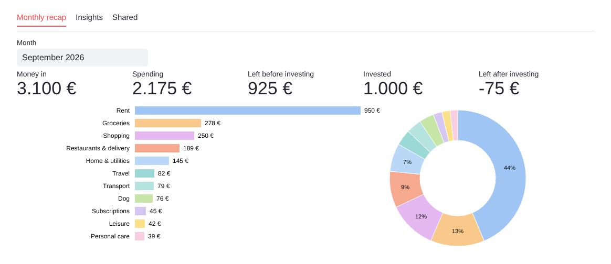
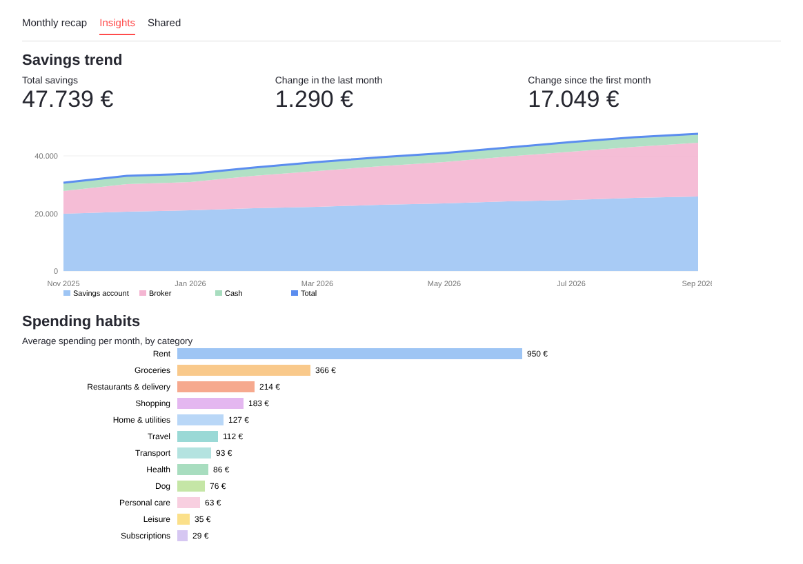

# Finance Buddy

A personal-finance tool that turns bank and credit card statements into a clear monthly picture of income, spending, investing and savings.

Doing the monthly accounts by hand means downloading statements, tagging every payment and rebuilding the totals. Finance Buddy does it automatically.

## What it does

- Reads bank statements (XLS) and credit card statements (PDF) and merges them into one table.
- Categorizes every transaction: keyword rules first, then an LLM for the merchants the rules do not know, with a web search for the uncertain ones.
- Shows a dashboard with a monthly recap, a coloured report per category, spending habits and savings over time.
- Exports the monthly report to Excel.
- Learns from corrections: a category changed in the dashboard is remembered from then on.
- Splits expenses with a partner: pick the ones to share and see what is owed.

## How it works

1. **Parse and merge** the statements, with checks against the printed totals.
2. **Rules** for known merchants and bank descriptions.
3. **LLM** for the remaining merchants, with a confidence score.
4. **Web search** to double-check the uncertain ones.
5. **Dashboard** built with Streamlit, with corrections saved to disk.

Only merchant names are sent to the LLM, never amounts or personal details.

## Stack

Python, pandas, Streamlit, Plotly, LiteLLM (Gemini), local Ollama for the search step.

## To do

- Forecast: end-of-year savings under different monthly investment scenarios.
- LLM agent: a short written commentary on each month.
